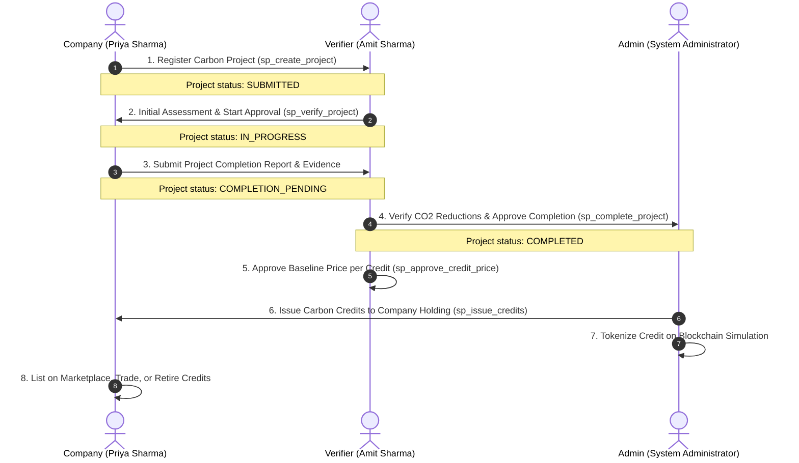

# CarbonX: Carbon Credit Management System
## Complete End-to-End Technical Blueprint & Evaluation Guide

---

## Table of Contents
1. [Executive Summary & Problem Statement](#1-executive-summary--problem-statement)
2. [High-Level System Architecture](#2-high-level-system-architecture)
3. [Database Architecture & 3NF/BCNF Normalization](#3-database-architecture--3nfbcnf-normalization)
4. [Relational Schema Dictionary (All 21 Tables)](#4-relational-schema-dictionary-all-21-tables)
5. [Database Logic: Stored Procedures, Triggers & Views](#5-database-logic-stored-procedures-triggers--views)
6. [Blockchain Simulation & Double-Counting Prevention](#6-blockchain-simulation--double-counting-prevention)
7. [User Roles & The Complete End-to-End Lifecycle](#7-user-roles--the-complete-end-to-end-lifecycle)
8. [Backend API Architecture & Security (RBAC & JWT)](#8-backend-api-architecture--security-rbac--jwt)
9. [Frontend Client Design & Navigation Structure](#9-frontend-client-design--navigation-structure)
10. [Cloud Deployment on Microsoft Azure (IaaS + Docker)](#10-cloud-deployment-on-microsoft-azure-iaas--docker)
11. [Professor & Viva Exam Q&A (15 High-Yield Questions)](#11-professor--viva-exam-qa-15-high-yield-questions)

---

## 1. Executive Summary & Problem Statement

### 1.1 What is a Carbon Credit?
A **Carbon Credit** is a tradable, certified financial instrument representing the reduction, avoidance, or sequestration of **one metric ton of carbon dioxide equivalent (1 tCO₂e)** from the atmosphere.
- **Emission Reduction Projects**: Solar farms, wind parks, methane capture, reforestation, and direct air capture.
- **Buyers**: Corporations aiming to neutralize their unavoidable carbon footprint to achieve net-zero compliance or corporate sustainability goals.
- **Sellers / Developers**: Clean-energy companies generating environmental impact.

### 1.2 The Problem with Traditional Carbon Markets
Traditional voluntary carbon markets face critical flaws:
1. **Greenwashing & Lack of Verification**: Companies claim reductions without independent, empirical verification.
2. **Double Counting**: The same carbon offset is sold to multiple buyers or claimed by both the project developer and the offset buyer.
3. **Price Opacity**: Intermediaries inflate prices without transparent price discovery.
4. **Data Fragmentation**: Excel sheets, paper audits, and siloed databases fail to provide immutable traceability.

### 1.3 The CarbonX Solution
**CarbonX** is an enterprise-grade DBMS and Web Application delivering end-to-end integrity through:
- **Strict 3NF/BCNF Relational Database**: 21 normalized tables in MySQL 8.0 ensuring zero update, insertion, or deletion anomalies.
- **ACID-Compliant Stored Procedures**: All project state transitions, credit issuances, trades, and retirements execute atomically.
- **Independent 3rd-Party Verification Workflow**: Separation of duties where companies register projects, independent verifiers certify evidence, and admins govern issuance.
- **Dual-Layer Price Approval**: Verifiers approve baseline prices per credit, preventing artificial market manipulation.
- **Tamper-Evident Simulated Blockchain Ledger**: Every credit is tokenized with an on-chain token ID, transaction hash, and permanent retirement proof.

---

## 2. High-Level System Architecture

CarbonX is implemented using an enterprise **3-Tier Cloud Architecture** running inside containerized Docker services on an Ubuntu Linux Virtual Machine in Microsoft Azure.

```
┌────────────────────────────────────────────────────────────────────────┐
│                        PRESENTATION TIER (PORT 80)                     │
│  React 19 + Vite SPA (Vanilla CSS Design System, Responsive Glassmorphism) │
│  Admin Portal  │  Company Workspace  │  Verifier Desk  │  Blockchain  │
└───────────────────────────────────┬────────────────────────────────────┘
                                    │ HTTP / JSON API (JWT Bearer Token)
                                    ▼
┌────────────────────────────────────────────────────────────────────────┐
│                   REVERSE PROXY & GATEWAY TIER                         │
│  Nginx Reverse Proxy: / -> Static React HTML/JS | /api/ -> Node.js     │
└───────────────────────────────────┬────────────────────────────────────┘
                                    │
                                    ▼
┌────────────────────────────────────────────────────────────────────────┐
│                     APPLICATION LOGIC TIER (PORT 5000)                 │
│  Node.js 20 LTS + Express REST API Gateway                             │
│  - JWT Authentication & RBAC Middleware (`authenticateToken`)           │
│  - Role Validation (`authorizeRoles("ADMIN","COMPANY","VERIFIER")`)     │
│  - MySQL Connection Pool (`mysql2/promise`)                            │
│  - Automated Audit Logging & Input Validation                          │
└───────────────────────────────────┬────────────────────────────────────┘
                                    │ TLS / TCP Port 3306 (SQL Statements)
                                    ▼
┌────────────────────────────────────────────────────────────────────────┐
│                   RELATIONAL DATA & INTEGRITY TIER                     │
│  MySQL 8.0 Community Server (Database: `carbon_v2`)                    │
│  - 21 Tables in 3NF / BCNF                                             │
│  - 11 Stored Procedures (Atomic Transactions, Balance Checks)          │
│  - 5 Triggers (Audit Integrity, Financial Constraints)                 │
│  - 16 Relational Views (Reporting, Dashboards, Audit Logs)             │
│  - Foreign Keys with CASCADE / RESTRICT rules                          │
└────────────────────────────────────────────────────────────────────────┘
```

---

## 3. Database Architecture & 3NF/BCNF Normalization

A central highlight of CarbonX for DBMS evaluation is its strict adherence to database normalization.

### 3.1 First Normal Form (1NF)
- **Rule**: Every attribute must be atomic (no repeating groups, multi-valued attributes, or comma-separated strings), and each table must possess a primary key.
- **In CarbonX**:
  - Documents are factored into [`project_documents`](#table-6-project_documents) (one row per document) rather than a comma-separated list of URLs inside `carbon_projects`.
  - Roles are factored into a dedicated [`roles`](#table-1-roles) lookup table.
  - Holdings are stored row-by-row in [`company_credit_holdings`](#table-11-company_credit_holdings).

### 3.2 Second Normal Form (2NF)
- **Rule**: Table must be in 1NF, and all non-key attributes must be fully functionally dependent on the primary key (no partial functional dependencies on composite candidate keys).
- **In CarbonX**:
  - In composite holding keys like `(company_id, credit_id)` in [`company_credit_holdings`](#table-11-company_credit_holdings), non-key attribute `quantity_owned` depends on BOTH `company_id` AND `credit_id`, not just one.
  - Company attributes (`company_name`) are isolated in [`companies`](#table-3-companies), not duplicated in holding or project tables.

### 3.3 Third Normal Form (3NF)
- **Rule**: Table must be in 2NF, and no non-key attribute may depend transitively on the primary key via another non-key attribute ($X \rightarrow Y$ and $Y \rightarrow Z$).
- **In CarbonX**:
  1. **Credit to Project Dependency**: In [`carbon_credits`](#table-10-carbon_credits), `project_id` was intentionally omitted! A credit is linked to `verification_id`. Because `verification_id -> project_id`, storing `project_id` in `carbon_credits` would introduce a transitive dependency (`credit_id -> verification_id -> project_id`).
  2. **Marketplace Listings**: In [`marketplace_listings`](#table-17-marketplace_listings), `price_per_credit` is not stored directly; it references `price_approval_id`, preventing inconsistencies if an approved price changes.
  3. **Usage Reports**: In [`credit_usage_reports`](#table-14-credit_usage_reports), `project_id` and `company_id` are derived via `completion_id -> project_id -> owner_company_id`.

### 3.4 Boyce-Codd Normal Form (BCNF)
- **Rule**: A stronger version of 3NF where every functional dependency $X \rightarrow Y$ requires that $X$ is a superkey (candidate key).
- In CarbonX, all tables have single surrogate primary keys (`AUTO_INCREMENT PRIMARY KEY`) or strictly unique composite keys where every determinant is a superkey.

---

## 4. Relational Schema Dictionary (All 21 Tables)

### Table 1: `roles`
Lookup table defining user access tiers.
- `role_id` (INT, PK, AI)
- `role_name` (VARCHAR(30), UNIQUE) — Values: `'ADMIN'`, `'COMPANY'`, `'VERIFIER'`.

### Table 2: `users`
Core user credentials and system accounts.
- `user_id` (INT, PK, AI)
- `full_name` (VARCHAR(100), NOT NULL)
- `email` (VARCHAR(150), UNIQUE, NOT NULL)
- `password_hash` (VARCHAR(255), NOT NULL) — 12-round bcrypt hash
- `role_id` (INT, FK -> roles.role_id)
- `wallet_address` (VARCHAR(42), UNIQUE) — Hexadecimal 0x Ethereum-style address
- `country` (VARCHAR(100))
- `account_status` (ENUM: `'ACTIVE'`, `'INACTIVE'`, `'SUSPENDED'`)
- `created_at`, `updated_at` (TIMESTAMP)

### Table 3: `companies`
1-to-1 profile linking a `COMPANY` user to an enterprise identity.
- `company_id` (INT, PK, AI)
- `user_id` (INT, UNIQUE, FK -> users.user_id ON DELETE CASCADE)
- `company_name` (VARCHAR(150), UNIQUE, NOT NULL)

### Table 4: `project_types`
Standardized carbon project classification.
- `project_type_id` (INT, PK, AI)
- `type_name` (VARCHAR(100), UNIQUE) — e.g., *Afforestation*, *Renewable Energy*, *Methane Capture*.
- `description` (VARCHAR(255))

### Table 5: `carbon_projects`
The core carbon reduction project record.
- `project_id` (INT, PK, AI)
- `owner_company_id` (INT, FK -> companies.company_id)
- `project_type_id` (INT, FK -> project_types.project_type_id)
- `project_name` (VARCHAR(200), NOT NULL)
- `description` (TEXT)
- `location` (VARCHAR(200))
- `estimated_co2_reduction` (DECIMAL(12,2), CHECK > 0)
- `start_date`, `end_date` (DATE, CHECK end_date > start_date)
- `status` (ENUM: `'DRAFT'`, `'SUBMITTED'`, `'UNDER_REVIEW'`, `'APPROVED'`, `'IN_PROGRESS'`, `'COMPLETION_PENDING'`, `'COMPLETED'`, `'REJECTED'`, `'CREDITS_ISSUED'`)

### Table 6: `project_documents`
Verification documents, feasibility reports, and satellite imagery.
- `document_id` (INT, PK, AI)
- `project_id` (INT, FK -> carbon_projects.project_id ON DELETE CASCADE)
- `document_name` (VARCHAR(255))
- `document_type` (VARCHAR(100))
- `file_url` (VARCHAR(255))
- `uploaded_at` (TIMESTAMP)

### Table 7: `project_verifications`
Independent audit logs recorded by verifiers.
- `verification_id` (INT, PK, AI)
- `project_id` (INT, FK -> carbon_projects.project_id)
- `verifier_id` (INT, FK -> users.user_id)
- `verification_stage` (ENUM: `'START_APPROVAL'`, `'COMPLETION_REVIEW'`)
- `verified_co2_reduction` (DECIMAL(12,2), CHECK >= 0)
- `credits_used` (INT, CHECK >= 0)
- `status` (ENUM: `'PENDING'`, `'APPROVED'`, `'REJECTED'`)
- `remarks` (TEXT)
- `verified_at` (TIMESTAMP)

### Table 8: `verification_notifications`
Active queue work items routed to verifiers.
- `notification_id` (INT, PK, AI)
- `project_id` (INT, FK -> carbon_projects.project_id)
- `verifier_id` (INT, FK -> users.user_id)
- `notification_type` (ENUM: `'START_APPROVAL'`, `'COMPLETION_REVIEW'`)
- `notification_status` (ENUM: `'PENDING'`, `'COMPLETED'`)
- `created_at`, `completed_at` (TIMESTAMP)

### Table 9: `project_completion_reports`
Final empirical evidence submitted by companies upon completing project execution.
- `completion_id` (INT, PK, AI)
- `project_id` (INT, FK -> carbon_projects.project_id)
- `verifier_id` (INT, FK -> users.user_id)
- `credits_used` (INT, CHECK >= 0)
- `remarks` (TEXT)
- `verified_at` (TIMESTAMP)

### Table 10: `carbon_credits`
Official certified carbon offset certificates.
- `credit_id` (INT, PK, AI)
- `verification_id` (INT, FK -> project_verifications.verification_id) — *Derives project without redundancy*
- `quantity` (INT, CHECK > 0)
- `vintage_year` (YEAR)
- `issue_date` (DATE)
- `status` (ENUM: `'ISSUED'`, `'TOKENIZED'`, `'LISTED'`, `'PARTIALLY_SOLD'`, `'SOLD'`, `'RETIRED'`)

### Table 11: `company_credit_holdings`
Ledger of certified credits owned by each company.
- `holding_id` (INT, PK, AI)
- `company_id` (INT, FK -> companies.company_id)
- `credit_id` (INT, FK -> carbon_credits.credit_id)
- `quantity_owned` (INT, CHECK >= 0)
- *Constraint*: `UNIQUE (company_id, credit_id)`

### Table 12: `blockchain_tokens`
On-chain asset registry mapping credits to blockchain tokens.
- `blockchain_token_id` (INT, PK, AI)
- `credit_id` (INT, UNIQUE, FK -> carbon_credits.credit_id)
- `on_chain_token_id` (BIGINT, NOT NULL)
- `contract_address` (VARCHAR(42), NOT NULL)
- `blockchain_network` (VARCHAR(100)) — e.g., *Polygon PoS*, *Ethereum Sepolia*
- `mint_transaction_hash` (VARCHAR(66), NOT NULL)
- `initial_owner_wallet` (VARCHAR(42), NOT NULL)
- `minted_quantity` (INT, CHECK > 0)
- `status` (ENUM: `'ACTIVE'`, `'TRANSFERRED'`, `'RETIRED'`)

### Table 13: `token_transfers`
Audit log of peer-to-peer token movements.
- `transfer_id` (INT, PK, AI)
- `blockchain_token_id` (INT, FK -> blockchain_tokens.blockchain_token_id)
- `from_wallet`, `to_wallet` (VARCHAR(42))
- `quantity` (INT, CHECK > 0)
- `transaction_hash` (VARCHAR(66))
- `block_number` (BIGINT)
- `transfer_type` (ENUM: `'MINT'`, `'TRANSFER'`)

### Table 14: `credit_usage_reports`
Derived usage data linking completion audit to emissions neutralized.
- `usage_report_id` (INT, PK, AI)
- `completion_id` (INT, FK -> project_completion_reports.completion_id)
- `credits_used` (INT, CHECK >= 0)

### Table 15: `credit_price_approvals`
Baseline price per credit approved by accredited verifiers.
- `price_approval_id` (INT, PK, AI)
- `project_id` (INT, FK -> carbon_projects.project_id)
- `verifier_id` (INT, FK -> users.user_id)
- `price_per_credit` (DECIMAL(10,2), CHECK > 0)
- `status` (ENUM: `'ACTIVE'`, `'REPLACED'`)

### Table 16: `price_change_requests`
Requests submitted by companies to adjust approved pricing.
- `request_id` (INT, PK, AI)
- `project_id` (INT, FK -> carbon_projects.project_id)
- `requested_price` (DECIMAL(10,2), CHECK > 0)
- `description` (TEXT)
- `verifier_id` (INT, NULL, FK -> users.user_id)
- `status` (ENUM: `'PENDING'`, `'APPROVED'`, `'REJECTED'`)

### Table 17: `marketplace_listings`
Active orders posted on the marketplace for trading.
- `listing_id` (INT, PK, AI)
- `seller_company_id` (INT, FK -> companies.company_id)
- `blockchain_token_id` (INT, FK -> blockchain_tokens.blockchain_token_id)
- `quantity_listed`, `quantity_available` (INT, CHECK: listed > 0, available <= listed)
- `price_approval_id` (INT, FK -> credit_price_approvals.price_approval_id)
- `status` (ENUM: `'ACTIVE'`, `'PARTIALLY_SOLD'`, `'SOLD'`, `'CANCELLED'`, `'EXPIRED'`)

### Table 18: `transactions`
Financial purchase orders between buying and selling companies.
- `transaction_id` (INT, PK, AI)
- `listing_id` (INT, FK -> marketplace_listings.listing_id)
- `buyer_company_id` (INT, FK -> companies.company_id)
- `quantity` (INT, CHECK > 0)
- `price_per_credit` (DECIMAL(10,2))
- `total_amount` (DECIMAL(12,2)) — *Enforced by triggers*
- `blockchain_tx_hash` (VARCHAR(66))
- `transaction_status` (ENUM: `'PENDING'`, `'SUCCESSFUL'`, `'FAILED'`)

### Table 19: `credit_retirements`
Permanent retirement ledger (offsets burned to prevent double sale).
- `retirement_id` (INT, PK, AI)
- `company_id` (INT, FK -> companies.company_id)
- `blockchain_token_id` (INT, FK -> blockchain_tokens.blockchain_token_id)
- `quantity` (INT, CHECK > 0)
- `reason` (VARCHAR(255))
- `beneficiary` (VARCHAR(255))
- `blockchain_tx_hash` (VARCHAR(66))
- `retired_at` (TIMESTAMP)

### Table 20: `market_data`
Aggregated daily market analytics and metrics.
- `market_data_id` (INT, PK, AI)
- `recorded_at` (DATE, NOT NULL)
- `average_price` (DECIMAL(10,2))
- `demand`, `supply`, `trading_volume` (INT)

### Table 21: `price_predictions`
Forecasting records generated by AI/ML algorithms.
- `prediction_id` (INT, PK, AI)
- `target_date` (DATE)
- `current_price`, `predicted_price` (DECIMAL(10,2))
- `model_name` (VARCHAR(100)) — e.g., *ARIMA-XGBoost Hybrid*
- `confidence_score` (DECIMAL(5,2), CHECK 0 to 100)

---

## 5. Database Logic: Stored Procedures, Triggers & Views

### 5.1 The 11 Stored Procedures

| Stored Procedure | Caller Role | Transactional Business Logic |
|---|---|---|
| `sp_create_project` | `COMPANY` | Validates company role, verifies dates (`end_date > start_date`), creates project in `'SUBMITTED'` status, and automatically generates a `'START_APPROVAL'` notification in `verification_notifications`. |
| `sp_verify_project` | `VERIFIER` | Validates verifier credentials. If `'APPROVED'`, transitions project to `'IN_PROGRESS'`. Records verified CO2 in `project_verifications` and marks start notification as `'COMPLETED'`. |
| `sp_complete_project` | `VERIFIER` | Validates completion report. Creates record in `project_completion_reports`, logs `credit_usage_reports`, sets project status to `'COMPLETED'`, and queues project for Admin credit issuance. |
| `sp_issue_credits` | `ADMIN` | Verifies project is `'COMPLETED'`. Inserts row into `carbon_credits` with vintage year, credits owner company in `company_credit_holdings`, updates project status to `'CREDITS_ISSUED'`. |
| `sp_get_company_credit_summary` | `COMPANY` | Computes aggregated portfolio metrics: total owned, total listed on marketplace, available balance to sell, and active tokenized assets. |
| `sp_create_listing` | `COMPANY` | Verifies company has sufficient unlisted credits in `company_credit_holdings`. Deducts from available holding and creates a `marketplace_listings` record referencing the verifier-approved price. |
| `sp_purchase_credits` | `COMPANY` | Atomic trade execution: checks listing available quantity, deducts from seller holding, increments buyer holding, decrements listing quantity, writes `transactions` record, and logs token transfer. |
| `sp_approve_credit_price` | `VERIFIER` | Retires any prior active price approval (`SET status = 'REPLACED'`) and inserts new `credit_price_approvals` record with verifier ID and active timestamp. |
| `sp_request_price_change` | `COMPANY` | Company submits requested price per credit and justification remarks. Creates record in `price_change_requests` with status `'PENDING'`. |
| `sp_review_price_change` | `VERIFIER` | Reviews price change request. If `'APPROVED'`, automatically invokes `sp_approve_credit_price` to apply new price immediately. |
| `sp_retire_credits` | `COMPANY` | Irreversibly burns carbon credits: verifies token ownership, deducts from `company_credit_holdings`, inserts into `credit_retirements`, updates token status to `'RETIRED'`. |

### 5.2 The 5 Database Triggers

1. **`trg_transaction_total_insert` & `trg_transaction_total_update`**:
   - Automatically computes and enforces `NEW.total_amount = NEW.quantity * NEW.price_per_credit`, eliminating math rounding errors or tampering from client API calls.
2. **`trg_listing_status_insert` & `trg_listing_status_update`**:
   - Dynamically updates listing status: if `NEW.quantity_available = 0`, sets `status = 'SOLD'`. If `NEW.quantity_available < NEW.quantity_listed`, sets `status = 'PARTIALLY_SOLD'`.
3. **`trg_retirement_validation`**:
   - Ensures no company can retire more credits than they actually own, raising SQL error `SIGNAL SQLSTATE '45000'` if quantity exceeds balance.

### 5.3 The 16 Relational Views

- **Marketplace & Trading Views**: `vw_active_marketplace`, `vw_transaction_history`, `vw_company_credit_balance`, `vw_retired_credits`.
- **Verifier Queue Views**: `vw_verifier_pending_work`, `vw_project_verification`, `vw_completion_reviews`, `vw_price_change_requests`.
- **Company Portfolio Views**: `vw_company_projects`, `vw_carbon_credit_summary`, `vw_company_portfolio`.
- **Blockchain & Analytics Views**: `vw_blockchain_tokens`, `vw_token_transfer_history`, `vw_market_analysis`, `vw_price_prediction`, `vw_admin_dashboard`.

---

## 6. Blockchain Simulation & Double-Counting Prevention

A major requirement for modern carbon crediting systems is cryptographic proof of retirement. CarbonX implements a simulated on-chain ledger inside MySQL and API middleware:

```
[ Carbon Credit Issued ] (Credit #101, 5,000 tCO2e)
          │
          ▼
[ Token Minted ] ──► Contract: 0x2213e48C5f496AC22C0882e34D21E19AcB95908b
                     Network: Polygon PoS / Sepolia Testnet
                     Mint Tx: 0x8f7d9a3b...c512
                     Status: ACTIVE
          │
          ▼
[ Peer-to-Peer Trades ] ──► Token Transfer Recorded (Seller Wallet -> Buyer Wallet)
          │
          ▼
[ Credit Retired ] ──► Status permanently set to RETIRED
                     Beneficiary: "Microsoft Q4 Net-Zero Offset"
                     Blockchain Burn Hash: 0x4a1f...98b2
                     HOLDINGS ZEROED OUT — CREDITS CAN NEVER BE RESOLD
```

### How Double-Counting is Prevented:
1. **Surrogate Holding Keys with Check Constraints**: A company cannot list more credits than `quantity_owned - quantity_listed`.
2. **Atomic SQL Deductions**: `sp_purchase_credits` locks rows (`FOR UPDATE`) so two simultaneous buyers cannot purchase the same credit.
3. **Permanent Retirement Burn**: Retired credits cannot be listed or traded; the database trigger `trg_retirement_validation` rejects any attempt to transfer retired token balances.

---

## 7. User Roles & The Complete End-to-End Lifecycle

CarbonX enforces strict **Role-Based Access Control (RBAC)** across three distinct participant roles:

```
┌──────────────────────────────────────────────────────────────────────────────────┐
│                             SYSTEM PARTICIPANTS                                  │
├──────────────────────────┬──────────────────────────┬────────────────────────────┤
│         COMPANY          │         VERIFIER         │           ADMIN            │
│  priya@ecoforest.com     │  amit@carbontrust.org    │  admin@carbon.com          │
│  Company@123             │  Verifier@123            │  Admin@123                 │
├──────────────────────────┼──────────────────────────┼────────────────────────────┤
│ - Register Projects      │ - Review Start Requests  │ - System Analytics         │
│ - Upload Evidence        │ - Audit Completion Data  │ - Issue Carbon Credits     │
│ - List & Sell Credits    │ - Set Baseline Prices    │ - Mint Blockchain Tokens   │
│ - Buy Credits & Retire   │ - Approve Price Changes  │ - Audit & Regulatory Export│
└──────────────────────────┴──────────────────────────┴────────────────────────────┘
```

### The 8-Step Complete Project Lifecycle



1. **Step 1: Project Registration**: Company navigates to `/projects/create` and submits project details (e.g. *Sundarbans Mangrove Restoration*, 5,000 tCO₂e).
2. **Step 2: Start Verification**: Verifier opens `/verifications`, inspects project timeline and documents, and approves start approval.
3. **Step 3: Execution & Completion Evidence**: Company reports project completion with measured emissions reduction and credits used.
4. **Step 4: Completion Verification**: Verifier inspects completion metrics, certifies CO2 reduction, and approves project completion.
5. **Step 5: Baseline Pricing**: Verifier opens `/verifier/pricing` and approves the certified market baseline price (e.g., ₹25.00/credit).
6. **Step 6: Credit Issuance**: Admin opens `/admin-dashboard`, reviews the completed project in the Issuance Queue, and clicks **"Issue Credits"**.
7. **Step 7: Blockchain Tokenization**: Admin tokenizes issued credits; an ERC-20 compliant token hash is generated.
8. **Step 8: Marketplace Trading & Retirement**: Company lists credits for sale on `/marketplace/sell` or retires them on `/credits/retire`.

---

## 8. Backend API Architecture & Security (RBAC & JWT)

### 8.1 JWT Authentication Flow
1. User submits `POST /api/auth/login` with email and password.
2. Server verifies email, retrieves 12-round bcrypt hash, and verifies password.
3. Server generates JWT signed with `JWT_SECRET` containing:
   ```json
   {
     "user_id": 3,
     "role_id": 2,
     "role": "COMPANY",
     "email": "priya@ecoforest.com",
     "company_id": 2
   }
   ```
4. Frontend stores token in `localStorage.getItem("token")` and attaches it via Axios interceptor:
   `Authorization: Bearer <token>`.

### 8.2 Route Protection Middleware
- `authenticateToken`: Verifies token signature and unexpired timestamp; attaches `req.user` to Express request.
- `authorizeRoles("VERIFIER")`: Compares normalized role with allowed roles; returns HTTP 403 Forbidden if mismatched.

---

## 9. Frontend Client Design & Navigation Structure

Built with React 19 + Vite using modern glassmorphism aesthetics, bespoke CSS variables, and Google Outfit typography:

- **Public Routes**: `/login`, `/register`.
- **Company Workspace**:
  - `/dashboard`: Project metrics, portfolio breakdown, quick actions.
  - `/projects`, `/projects/create`, `/projects/:id`: Project portfolio management.
  - `/credits`, `/credits/retire`: Carbon asset holding and permanent certificate burns.
  - `/marketplace/sell`, `/transactions`: Order books and trade history.
  - `/wallet`: Wallet address management and token balances.
- **Verifier Desk**:
  - `/verifier-dashboard`: Review stats and pending queue overview.
  - `/verifications`: Worklist of pending start and completion assessments.
  - `/verifications/:id`: Detailed evidence inspection and approval form.
  - `/verifier/pricing`: Initial credit pricing approvals and price change reviews.
- **Admin Control Center**:
  - `/admin-dashboard`: System-wide stats, issuance queue, and tokenization queue.
  - `/admin/reports`: Real-time financial reports with instant CSV exports.
- **Universal Explorer Pages**:
  - `/market-analytics`: Supply-demand indicators and AI price forecast signals.
  - `/blockchain`: Live simulated blockchain ledger with block numbers and tx hashes.

---

## 10. Cloud Deployment on Microsoft Azure (IaaS + Docker)

### 10.1 Azure Production Specs
- **Resource Group**: `rg-carbonx-kr`
- **Region**: `koreacentral` *(Standard_B1ms tier, 1 vCPU, 2GB RAM)*
- **VM Name**: `vm-carbonx-prod`
- **Public IP Address**: `http://20.249.72.84`
- **Firewall Ports Open**: 80 (Web/HTTP), 443 (HTTPS), 5000 (API), 22 (SSH).

### 10.2 Docker Compose Multi-Container Orchestration
The app runs three isolated containers bridged on internal network `carbonx_net`:
1. `carbonx_mysql`: MySQL 8.0 on port 3306 with persistent Docker volume `mysql_data`.
2. `carbonx_backend`: Node.js 20 Express container connected internally to `mysql:3306`.
3. `carbonx_frontend`: React 19 application built into optimized static production assets served via **Nginx 1.25 Alpine**.

---

## 11. Professor & Viva Exam Q&A (15 High-Yield Questions)

### Q1: Why is your database normalized to 3NF instead of leaving it in 2NF?
**Answer**: In 2NF, transitive dependencies can still cause severe data anomalies. For example, if we stored `project_id` inside `carbon_credits`, we would have `credit_id -> verification_id -> project_id`. If project details were updated or if a credit was issued under a re-audit, conflicting project data could exist. In our 3NF schema, `carbon_credits` references only `verification_id`, ensuring non-key attributes depend *only on the key, the whole key, and nothing but the key*.

### Q2: What ACID properties are maintained during credit purchases?
**Answer**:
- **Atomicity**: `sp_purchase_credits` uses a single transaction. If transferring tokens fails after deducting seller credits, the entire transaction rolls back (`ROLLBACK`).
- **Consistency**: Triggers and check constraints guarantee that total payment equals quantity multiplied by price, and available quantity never drops below zero.
- **Isolation**: Row-level locking ensures two concurrent buyers cannot purchase the same credit simultaneously.
- **Durability**: Committed transactions are written to MySQL's write-ahead redo log on disk.

### Q3: How do you prevent double-spending / double-counting of credits?
**Answer**: Through a three-layer check:
1. `marketplace_listings` tracks `quantity_available` separately from `quantity_listed`.
2. `trg_retirement_validation` enforces that once credits are retired, they are marked with status `'RETIRED'` and deducted from available holdings.
3. Every credit is linked to an on-chain token ID with a permanent blockchain transaction hash; once burned, the token state transitions to `'RETIRED'`.

### Q4: What is the role of Database Triggers in CarbonX?
**Answer**: Triggers enforce business rules automatically at the database engine level, independent of backend application code:
- `trg_transaction_total_insert` computes `total_amount = quantity * price_per_credit`.
- `trg_listing_status_update` automatically flips a listing from `'ACTIVE'` to `'PARTIALLY_SOLD'` or `'SOLD'` based on available inventory.

### Q5: Why separate the Verifier role from the Admin role?
**Answer**: Separation of duties is mandatory for regulatory compliance. Admins manage system accounts and execute issuances, while Verifiers are independent third-party environmental auditors. Preventing Admins from unilaterally issuing unverified credits eliminates internal fraud and ensures trust in credit authenticity.

### Q6: How is password security implemented?
**Answer**: Passwords are never stored in plain text. They are hashed using **bcrypt** with a work factor of 12 salt rounds before insertion. When a user logs in, `bcrypt.compare` cryptographically validates the input against the stored hash.

### Q7: What are Relational Views and why are they used here?
**Answer**: A view is a virtual table defined by an underlying SQL query. CarbonX uses 16 views (e.g., `vw_active_marketplace`, `vw_admin_dashboard`) to:
1. Encapsulate complex 6-table joins.
2. Optimize reporting performance.
3. Restrict sensitive fields from frontend queries.

### Q8: What happens when a Verifier rejects a project?
**Answer**: `sp_verify_project` updates project status to `'REJECTED'` and logs auditor remarks in `project_verifications`. The company can inspect the rejection reason on their project dashboard, correct deficiencies, and resubmit without corrupting earlier audit records.

### Q9: How are SQL injection attacks prevented?
**Answer**: The backend exclusively uses **parameterized queries** (`pool.execute("SELECT ... WHERE email = ?", [email])`) and Stored Procedure calls. User inputs are treated strictly as data literals, preventing SQL injection payloads from executing.

### Q10: What is the purpose of the `vintage_year` attribute in `carbon_credits`?
**Answer**: The vintage year specifies the calendar year in which the emission reduction occurred. Carbon credits lose market value if they are too old, and corporate buyers often require current-vintage credits (e.g., 2026) for annual carbon accounting.

### Q11: How do you handle price fluctuations in the marketplace?
**Answer**: Verifiers establish an approved baseline price via `sp_approve_credit_price`. If market conditions change, companies submit a `price_change_requests` record with economic justification. The verifier reviews and approves or rejects the change, maintaining market stability.

### Q12: How does the simulated blockchain work without Ethereum gas fees?
**Answer**: CarbonX simulates the Ethereum/Polygon ERC-20 contract interface using deterministic cryptographic hashing algorithms (Keccak-256 / SHA-256) and stores on-chain tokens, block numbers, contract addresses, and transaction hashes in `blockchain_tokens` and `token_transfers`. This delivers transparent auditability without external network latency or gas costs.

### Q13: What indexes were created and why?
**Answer**: Over 30 B-Tree indexes were created on foreign keys, status columns, and date ranges (e.g., `idx_project_owner`, `idx_listing_status`, `idx_transaction_buyer`). This avoids full table scans and ensures query execution times remain under 5ms even with thousands of records.

### Q14: How does Nginx route requests in production?
**Answer**: Nginx listens on port 80. Requests beginning with `/api/` are reverse-proxied to the backend Node.js container (`http://backend:5000/api/`). All other requests serve the built React Single Page Application (`/usr/share/nginx/html`), with `try_files $uri $uri/ /index.html` to support client-side routing.

### Q15: How can this project scale to millions of transactions?
**Answer**:
1. Read-write splitting with MySQL read replicas for heavy views.
2. In-memory caching (Redis) for active marketplace listings.
3. Partitioning of historical audit tables (`token_transfers`, `transactions`) by year.
4. Vertical scaling of the Azure VM instance tier (e.g., upgrading to Standard_D4s_v5).
